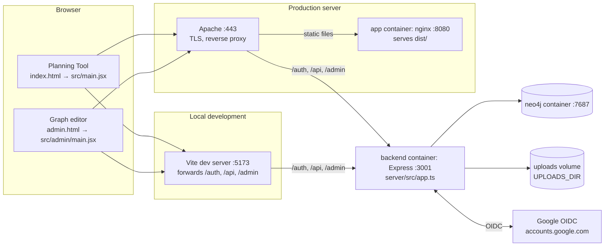

# Architecture

This page shows how the planning tool's pieces fit together: the main app + the admin graph editor, the
Express backend, the Neo4j graph database, and Google sign-in.

- Data fields are in [data-model.md](data-model.md).
- Environment variables are in [configuration.md](configuration.md).
- Instructions for setting up the production server are in [deployment.md](deployment.md).

## System overview



Things to be aware of:

- **The build outputs two front-ends.** `vite.config.js` declares two inputs: `index.html`
  for the wizard and `admin.html` for the graph editor. They share
  `src/contexts/AuthContext.jsx`, `src/theme.css` and parts of `src/components/`.
- **HTTP requests work differently depending on the environment.**
  - In development, Vite forwards `/auth`, `/api` and the exact path `/admin` to the backend.
  - In production, Apache sends those paths to the backend on `127.0.0.1:3001` and everything
    else to the `app` container on port 8080. See [deployment.md](deployment.md).

## Backend

The backend lives in `server/`. `server/src/server.ts` starts the app built in
`server/src/app.ts`. `server/src/config.ts` loads and validates the configuration once. See
[configuration.md](configuration.md).

### Middleware order

1. `app.set('trust proxy', 1)` makes `req.secure` respect the `X-Forwarded-Proto` header.
   Without it, Express silently drops secure cookies behind the reverse proxy.
2. `cors({ origin: WEB_ORIGIN, credentials: true })`.
3. `express.json()`.
4. `express-session`:
   - The cookie is `connect.sid`, httpOnly and `sameSite: 'lax'`.
   - The cookie is `secure` when `NODE_ENV=production`.
   - Sessions expire after 7 days.
   - The store is the default in-memory store.
5. The routers, mounted in the order of the route table below.

### Connector pattern

Each feature lives in `server/src/connectors/<name>/`, usually as three files:

- `types.ts` defines the data shapes and a `*Repository` interface.
- `neo4j*Repository.ts` implements the interface. All Cypher code lives here.
- `routes.ts` is an Express `Router`. It validates input, often with zod, calls the
  repository, and turns errors into JSON `{ error }` responses.

The connectors:

| Connector   | Job                                                       |
| ----------- | --------------------------------------------------------- |
| `oidc`      | Google sign-in.                                           |
| `graph`     | Wizard content.                                           |
| `progress`  | Each user's place in the wizard.                          |
| `resources` | PDF uploads.                                              |
| `admins`    | The admin list.                                           |
| `neo4j`     | `driver.ts` creates one shared Neo4j driver on first use. |
| `xapi`      | A README describing a future integration. No code.        |

The graph connector has a second implementation, `stubRepository.ts`:

- It serves `docs/wizardGraph.json` from memory when `GRAPH_BACKEND=stub`.
- Writes to it are lost on restart.
- Progress and admins always use Neo4j, so the stub only helps rough front-end work.

### Authorization

`server/src/middleware.ts` has two guards:

- `requireAuth` requires a signed-in user on the session. Otherwise it returns 401.
- `requireAdmin` requires a signed-in user whose email passes `isAdminEmail`. Otherwise it
  returns 401 or 403.

`isAdminEmail` lives in `connectors/admins/isAdminEmail.ts`. It lowercases the email and
returns true in either of two cases:

- The email is in the `ADMIN_EMAILS` env var. This is a break-glass list, so a fresh or
  unreachable database still has an admin.
- The email matches an `(:Admin)` node in Neo4j.

If the Neo4j lookup throws, only `ADMIN_EMAILS` counts.

### Routes

| Method   | Path                          | Guard          | Purpose                                                                 |
| -------- | ----------------------------- | -------------- | ----------------------------------------------------------------------- |
| `GET`    | `/healthz`                    | none           | Readiness info: `{ status, connectors }`.                               |
| `GET`    | `/auth/login`                 | none           | Starts Google sign-in with PKCE and redirects to Google.                |
| `GET`    | `/auth/callback`              | none           | Google's redirect target. Creates the session.                          |
| `POST`   | `/auth/logout`                | none           | Destroys the session and clears the cookie.                             |
| `GET`    | `/auth/me`                    | session        | The current user: `{ sub, email, name, picture, isAdmin }`. Or 401.     |
| `GET`    | `/api/graph`                  | `requireAuth`  | The whole wizard graph: `{ startNodeId, nodes, edges }`.                |
| `PUT`    | `/api/graph`                  | `requireAdmin` | Replaces the whole graph. Used by the graph editor.                     |
| `GET`    | `/api/graph/nodes/:id`        | `requireAuth`  | One node.                                                               |
| `POST`   | `/api/graph/nodes`            | `requireAdmin` | Creates a node from body `{ node }`. Returns 409 if the id exists.      |
| `PATCH`  | `/api/graph/nodes/:id`        | `requireAdmin` | Merges fields into a node. A `null` value clears that field.            |
| `DELETE` | `/api/graph/nodes/:id`        | `requireAdmin` | Deletes a node and its relationships. Refuses `welcome`.                |
| `POST`   | `/api/graph/edges`            | `requireAdmin` | Creates an edge from body `{ sourceId, edge }`.                         |
| `PATCH`  | `/api/graph/edges/:id`        | `requireAdmin` | Updates an edge, including its target.                                  |
| `DELETE` | `/api/graph/edges/:id`        | `requireAdmin` | Deletes an edge.                                                        |
| `GET`    | `/api/progress`               | `requireAuth`  | The signed-in user's saved progress, or `null`.                         |
| `PUT`    | `/api/progress`               | `requireAuth`  | Saves `{ currentNodeId, answers, history }`.                            |
| `DELETE` | `/api/progress`               | `requireAuth`  | Clears saved progress. Used by "Start over".                            |
| `POST`   | `/api/resources/upload`       | `requireAdmin` | Accepts a PDF up to 25 MB in multipart field `file`. Returns `{ url }`. |
| `GET`    | `/api/resources/files/<name>` | `requireAuth`  | Serves an uploaded PDF from `UPLOADS_DIR`.                              |
| `GET`    | `/api/admins`                 | `requireAdmin` | `{ admins, bootstrap }`: Neo4j admins and the `ADMIN_EMAILS` list.      |
| `POST`   | `/api/admins`                 | `requireAdmin` | Adds an admin from body `{ email }`.                                    |
| `DELETE` | `/api/admins/:email`          | `requireAdmin` | Removes an admin. Refuses your own email and the last admin.            |
| `GET`    | `/admin`                      | session        | The gate for the graph editor. See below.                               |

## Sign-in

Sign-in uses Google OIDC and runs entirely on the backend, in `server/src/connectors/oidc/`,
with `openid-client` and `express-session`. The browser only ever holds a session cookie.

Setup: create a Google OAuth client and set `GOOGLE_CLIENT_ID`, `GOOGLE_CLIENT_SECRET` and
`GOOGLE_REDIRECT_URI`. See [Google OAuth client](configuration.md#google-oauth-client).

- `src/contexts/AuthContext.jsx` calls `/auth/me` once on load. It exposes
  `{ user, loading, signOut }`. Both front-ends wrap their tree in `AuthProvider`.
- After sign-in, the browser goes to `session.returnTo` if it is set. Only `/admin` sets it.
  Otherwise the browser goes to the origin of `GOOGLE_REDIRECT_URI`. That variable therefore
  also decides where users land.
- The backend discovers the OIDC client from `https://accounts.google.com` on first use and
  caches it.
- Nothing records sign-ins. A `(:User)` node appears only when a user's progress is first
  saved.

### The `/admin` gate

`GET /admin` lives in `server/src/app.ts`:

- Signed-out users are redirected to `/auth/login`, with `returnTo` set to `/admin`.
- Non-admins get a 403 page.
- Admins are redirected to `/admin.html`, the static editor bundle.

`admin.html` itself is a public static file. The real protection is that every write route
requires an admin, and `AdminApp` shows a 403 screen when `user.isAdmin` is false.

## Front-end structure

The front-end code lives in `src/`.

### Component and provider tree

```
main.jsx
└─ AuthProvider                 contexts/AuthContext.jsx
   └─ App.jsx
      └─ DrawerProvider         contexts/DrawerContext.jsx: sidebar open or closed
         └─ AppWithEngine       creates useGraphEngine()
            └─ EditModeProvider contexts/EditModeContext.jsx: admin inline editing
               └─ AppContent    loads and saves progress, shows the resume screen
                  └─ WizardNavProvider  contexts/WizardNavContext.jsx: graph and overlays for deep children
                     ├─ EditModeBar
                     ├─ SignInScreen | ResumeScreen | NodeRenderer
                     ├─ Breadcrumb
                     └─ ResourceLibraryOverlay, FaqOverlay, GlossaryOverlay
```

### Graph engine

`src/graph/useGraphEngine.js` is the wizard's state machine. It fetches `/api/graph` once and
holds four pieces of state:

| State           | Meaning                                                               |
| --------------- | --------------------------------------------------------------------- |
| `graph`         | `{ startNodeId, nodes, edges }` from the API, or the edit-mode draft. |
| `currentNodeId` | The screen on display.                                                |
| `answers`       | `{ [storeKey]: value }`, collected from the edges the user took.      |
| `history`       | A stack of visited node ids, used by Back.                            |

Actions:

- `advance(edgeId, dynamicValue?)` follows an edge.
  - If the edge has a `storeKey`, it records `edge.value`.
  - If the edge has no `value`, it records `dynamicValue` instead. The checkbox submit uses
    this.
  - It pushes the current node onto `history`.
- `back()` pops `history`. The browser Back button does the same: every navigation calls
  `history.pushState`, and a `popstate` listener calls `back()`.
- `jumpAlongPath(edgeIds)` serves the sidebar. It replays a chain of edges, records each
  edge's fixed `value`, and jumps to the last edge's target.
- `goToNode(id)` serves edit mode. It jumps straight to a screen.
- `restore(progress)` loads saved progress. `resetToStart()` wipes it.

`src/components/NodeRenderer.jsx` picks a component from `src/components/nodes/` by
`node.type`. The types are `welcome`, `multiChoice`, `radioSurvey`, `checkboxSurvey`,
`videoInfo` and `results`.

- It passes in the node's edges in `edgeIds` order.
- Edge components in `src/components/edges/` render each option and call `advance`.
- `ResultsNode` picks its content with `src/graph/resolveResult.js`. See
  [Resolvers](data-model.md#resolvers).

### Navigation helpers

These are pure functions in `src/graph/`. They rerun from the graph on every render and store
nothing.

- `getNodePath` runs a breadth-first search from the start node to the current node. It skips
  disabled edges. It feeds the breadcrumb and the sidebar's active row. It returns the
  structural path, not the user's click history.
- `getPreviousAnswerLabel` finds the label of the edge that led into the current screen. The
  screen shows it as a heading. It applies only when the previous node was a `multiChoice` or
  a `radioSurvey`.
- `buildUseCaseTree` builds the "Your Goals" sidebar in `components/shared/UseCaseNav.jsx`. It
  walks forward from the start node:
  - It passes through screens with a single button.
  - Every option on the first `multiChoice` screens becomes a row.
  - Rows nest up to two levels deep.
  - Nothing is hard-coded, so new options appear automatically.

### Saved progress

`AppContent` in `src/App.jsx` handles progress in three steps:

1. After sign-in it calls `GET /api/progress`.
   - On a page refresh it restores progress silently. It detects a refresh with the
     `session-user` key in `sessionStorage`.
   - On a fresh sign-in it shows `ResumeScreen` first.
2. Every change to `currentNodeId`, `answers` or `history` sends `PUT /api/progress`. Saving
   is skipped in three cases:
   - The resume screen is showing.
   - The user is still on the untouched start screen.
   - Edit mode is on, so admins don't overwrite their own place.
3. "Start over" sends `DELETE /api/progress` and resets the engine.

### Content outside the graph

The Resource Library, FAQ and Glossary overlays read hard-coded data:

- `src/data/staticResources.js`
- `src/data/faqData.js`
- `src/data/glossaryData.js`

Changing them needs a code change and a deploy.

## Editing content

Admins have two ways to change the graph. Both write to the same Neo4j data, in different
ways.

### 1. Inline edit mode

Admins open **Edit Mode** from the user menu in `components/auth/UserMenu.jsx`. Edit mode
lives in `contexts/EditModeContext.jsx`.

- It edits the wizard's own graph state. Every screen shows the draft exactly as a visitor
  would see it.
- Text becomes editable in place through `components/edit/EditableText.jsx`.
- Buttons can be added, removed, reordered and re-targeted.

Saving works like this:

1. Draft changes go through the pure functions in `src/graph/editMutations.js`.
2. **Save** runs `diffGraph(baseline, draft)` from `src/graph/diffGraph.js`. It produces an
   ordered list of small operations: create nodes, create edges, update nodes, update edges,
   delete edges, delete nodes. Node updates include the edge order.
3. `applyGraphOps` in `src/graph/applyGraphOps.js` sends them one by one to the `POST`,
   `PATCH` and `DELETE /api/graph/...` routes.
4. It stops at the first failure and reports how many changes were applied. The rest of the
   draft stays on screen so the admin can retry.

Only changed screens and buttons are sent. Two admins editing different screens don't
overwrite each other.

### 2. Graph editor

`src/admin/AdminApp.jsx` is a React Flow canvas for the whole graph, served at `/admin`.

- Admins drag nodes, connect and reconnect edges, add nodes, undo and redo.
- **Auto-arrange** lays the graph out with dagre, in `src/admin/state/layout.js`.
- The inspector panel in `src/admin/components/Inspector/` edits node and edge fields. For
  results screens it includes the resolver editor from
  `src/components/editor/ResolversEditor/`.
- The Admins modal manages `(:Admin)` nodes.

`src/admin/state/graphFlowAdapter.js` converts between the API shape and React Flow's node and
edge arrays. Each flow edge stores its index in the source node's `edgeIds` as `data.order`.

**Save** converts back and sends the whole graph to `PUT /api/graph`. That route deletes every
`WizardNode` and `OPTION` and rewrites them. Node positions, `positionX` and `positionY`, are
saved this way too.

### PDF uploads

An admin can upload a PDF in the resolver editor, `ResolversEditor/ResourceRow.jsx`, instead
of pasting a URL.

1. The backend stores the file in `UPLOADS_DIR` under a random UUID name.
2. It returns `/api/resources/files/<uuid>.pdf`.
3. The editor saves that path as the resource's `url`.

Only signed-in users can fetch the files. Nothing ever deletes uploaded files, even when no
resource uses them.

## Peripheral and legacy pieces

- **`docs/index.html`** is the original standalone graph editor, built on Mermaid. GitHub
  Pages still publishes it from `main:/docs`. It is not connected to Neo4j.
- **`.github/workflows/update-wizard-graph.yml`** is a manual workflow the legacy editor used
  to commit a new `docs/wizardGraph.json`. Nothing reads that file at runtime, so the workflow
  no longer affects the live app.
- **`.github/workflows/add-to-project.yml`** adds new issues to the INFERable org project
  board.
- **`server/src/connectors/xapi/`** is a placeholder for a future xAPI learning-analytics
  integration. No code exists yet.

## Known quirks and gotchas

- **The two save paths can overwrite each other.** The graph editor's `PUT /api/graph`
  rewrites the whole graph from the editor's copy. Any inline edit-mode save made after the
  editor loaded is lost. Reload the editor before saving if someone may have edited inline.
- **Sessions are in memory.**
  - Restarting the backend signs everyone out.
  - A second backend instance would break sign-in.
  - Scaling out needs a persistent store such as Redis.
- **Duplicate dev servers break sign-in.** Two running `tsx watch` backend processes each keep
  their own session store. Requests can land on either one, which shows up as
  `Missing PKCE session` on `/auth/callback`. Kill the stale process.
- **The start node is hard-coded.** `neo4jRepository.getWizardGraph` always returns
  `welcome` as `startNodeId`. The per-node delete route refuses to delete it.
- **Leftover Google client config.** `VITE_GOOGLE_CLIENT_ID` and the `@react-oauth/google`
  dependency come from the old client-side sign-in. The Dockerfile and `compose.yaml` still
  pass the variable. Nothing in `src/` uses either.
- **Some node fields do nothing.** `layout` and `challengeBar` are stored and editable, but
  no component reads them. `checkboxSurvey` ignores `submitLabel`. See
  [data-model.md](data-model.md#quirks).
- **Vite accepts only listed hostnames.** `vite.config.js` has a hard-coded `allowedHosts`
  list. Add your hostname there to reach the dev server through a tunnel or a LAN name.
