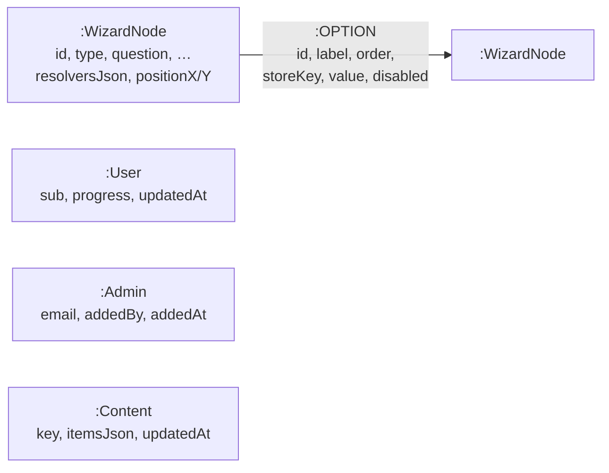

# Data model

All persistent data lives in one Neo4j database:

- the tool's content graph
- each user's saved progress
- the admin list

Uploaded PDFs are the only data outside Neo4j. They are files in `UPLOADS_DIR`. See
[architecture.md](architecture.md#pdf-uploads).

The wizard graph exists in three shapes.

1. **Neo4j storage:** `:WizardNode` nodes joined by `:OPTION` relationships.
2. **API JSON:** the `WizardGraph` type in `server/src/connectors/graph/types.ts`.
   `GET /api/graph` returns it, and the client works with it.
3. **Graph editor state:** React Flow node and edge arrays. Only `/admin` uses this shape. The
   conversion lives in `src/admin/state/graphFlowAdapter.js`.

> The live database is the only source of wizard content. No content file is checked in.

## Neo4j schema



`:User`, `:Admin` and `:Content` nodes stand alone. They have no relationships.

**`:WizardNode`**

- Written by `connectors/graph/neo4jRepository.ts`. The bootstrap script creates the
  `welcome` node.
- Holds `id` plus every node field listed below.
- `resolvers` is stored as a JSON string in `resolversJson`.
- `edgeIds` is not stored.

**`:OPTION`**

- Written by `connectors/graph/neo4jRepository.ts`.
- Always has `id`, `label` and `order`. `order` is the zero-based position among the source
  node's options.
- May have `storeKey`, `value` and `disabled`.

**`:User`**

- Written by `connectors/progress/neo4jProgressRepository.ts`.
- `sub` is the Google subject id.
- `progress` is a JSON string.
- `updatedAt` is a datetime.

**`:Admin`**

- Written by `connectors/admins/neo4jAdminRepository.ts`.
- `email` is trimmed and lowercased.
- `addedBy` is the email of the admin who added it.
- `addedAt` is a datetime.

**`:Content`**

- Written by `connectors/content/neo4jContentRepository.ts`.
- `key` is `resources`, `faq` or `glossary`. There is one node per key.
- `itemsJson` is the whole list as a JSON string. A save replaces it.
- `updatedAt` is a datetime.

The bootstrap script creates three uniqueness constraints with `IF NOT EXISTS`:

- `:WizardNode(id)`
- `:Admin(email)`
- `:Content(key)`

`:User.sub` has no constraint. Progress writes use `MERGE` on it.

### How storage maps to the API

The mapping code is `nodeToProps` and `edgeToRelProps` in
`server/src/connectors/graph/graphUtils.ts`, and `buildNode` and `buildEdge` in
`neo4jRepository.ts`.

- **Edges belong to nodes implicitly.** An API edge has no `sourceId`. It belongs to whichever
  node lists it in `edgeIds`. In Neo4j the owner is the relationship's start node.
- **`edgeIds` order comes from `OPTION.order`.** A read collects the outgoing `OPTION` ids
  sorted by `order`. To reorder options, `PATCH` the node with a new `edgeIds` array. The
  repository then rewrites each relationship's `order`.
- **`resolvers` round-trips through JSON.** It is written as `resolversJson` and parsed back on
  read. Every other node field is a plain property, so node fields must be primitives or
  arrays of primitives.
- **`null` clears a field.** `PATCH` bodies go into Cypher `SET n += $props`. Setting a
  property to `null` removes it. `diffGraph` relies on this to delete fields.
- **Re-targeting an edge recreates it.** Neo4j can't move a relationship's end node.
  `updateEdge` deletes the relationship and creates a new one with the same properties and
  `order`.
- **`startNodeId` is hardcoded as `"welcome"` in `getWizardGraph`.**

## Wizard graph JSON

```json
{
  "startNodeId": "welcome",
  "nodes": { "<nodeId>": { "id": "<nodeId>", "type": "multiChoice", "edgeIds": ["<edgeId>"] } },
  "edges": { "<edgeId>": { "id": "<edgeId>", "label": "Employer", "targetNodeId": "<nodeId>" } }
}
```

A **node** maps to one screen. An **edge** is one option or button on a screen that targets another screen.

### Fields on every node

| Field          | Type     | Notes                                                                                    |
| -------------- | -------- | ---------------------------------------------------------------------------------------- |
| `id`           | string   | Unique. New nodes get `node-<n>`. The graph editor can rename it.                        |
| `type`         | string   | Picks the component in `src/components/nodes/`. Values are listed in the next table.     |
| `edgeIds`      | string[] | This screen's options in display order. Derived from Neo4j, not stored.                  |
| `label`        | string   | Optional name shown on the graph editor canvas. Falls back to `id`.                      |
| `layout`       | string   | `hero` or `compact`. Stored and editable, but nothing renders it. See [Quirks](#quirks). |
| `challengeBar` | boolean  | Stored and editable, but nothing renders it. See [Quirks](#quirks).                      |
| `positionX/Y`  | number   | Canvas position in the graph editor. The editor lays out nodes that have none.           |

### Node types

Each type's fields come from its component in `src/components/nodes/`. New nodes start with
the values in `NODE_TYPE_DEFAULTS`, in `src/admin/components/nodes/nodeTypeMeta.js`.

**`welcome`**

- Renders `heading` and `body` on a hero screen.
- Renders only the **first** edge, as the call-to-action button.

**`multiChoice`**

- Renders `question` and one button per edge.
- Tapping a button advances immediately.
- These screens also build the sidebar's "Your Goals" tree.

**`radioSurvey`**

- Renders `intro`, `question` and one radio button per edge. `intro` is optional.
- The submit button follows the selected edge. Its label is `submitLabel`, which defaults to
  `Next`.

**`checkboxSurvey`**

- Renders `question` and one checkbox per edge.
- The submit button follows the edge named in `submitEdgeId`. Its label is that edge's
  `label`.
- The submit edge's `storeKey` receives an **array of the selected edge ids**.

**`videoInfo`**

- Renders `intro` and a video card from `videoUrl` and `videoAlt`.
- Optionally shows `linkLabel` and a link to `videoUrl` displayed as `linkDisplay`.
- Renders only the **first** edge, as the continue button.

**`results`**

- The end screen.
- Picks its content from `resolvers` based on the user's answers.
- Renders no outgoing edges.

The live content uses only `welcome`, `multiChoice`, `radioSurvey` and `results`.

### Edge fields

| Field          | Type    | Notes                                                                                                                      |
| -------------- | ------- | -------------------------------------------------------------------------------------------------------------------------- |
| `id`           | string  | Unique across the graph. New edges get `e_<sourceId>_<targetId>`. If taken, `_<n>` is added.                               |
| `label`        | string  | The button or option text.                                                                                                 |
| `targetNodeId` | string  | The screen this edge leads to.                                                                                             |
| `storeKey`     | string  | Optional. Taking the edge sets `answers[storeKey]`.                                                                        |
| `value`        | string  | The value stored at `storeKey`. When missing, the value passed to `advance()` is used. The checkbox submit relies on this. |
| `disabled`     | boolean | Optional. The option shows but can't be clicked. Breadcrumb, path and sidebar logic skip it.                               |

### Answers

`answers` is a flat object that grows as the user moves through the wizard. Example:
`{ "category": "employer", "role": "…", "challenge": "…" }`.

- Taking a second edge with the same `storeKey` overwrites the earlier value.
- The live graph uses the keys `category`, `role`, `challenge` and `skills-framework`.
- Answers are saved with progress.
- Answers select a results screen's content.

## Resolvers

A `results` node has an ordered `resolvers` array. `src/graph/resolveResult.js` renders the
**first** resolver whose `when` matches the current answers. If none match, it renders the
**last** one.

```json
{
  "when": { "challenge": ["ced-01", "ced-02"], "role": ["employer"] },
  "recommendation": "Lead sentence, shown highlighted.",
  "bodyText": "Supporting text.",
  "resources": [],
  "footer": "Closing line."
}
```

How `when` matches:

- **Every** key must match. Keys combine with AND.
- A key matches when the user's answer is **one of** its listed values. Values combine with OR.
- An empty `when: {}` always matches. Use it as a catch-all in the last resolver.

| Field                  | Notes                                                                      |
| ---------------------- | -------------------------------------------------------------------------- |
| `when`                 | Required. Matching rules are above.                                        |
| `recommendation`       | Lead sentence.                                                             |
| `bodyText`             | Body copy.                                                                 |
| `resources`            | Resource cards, rendered in array order. See below.                        |
| `footer`               | Small closing line.                                                        |
| `videoUrl`, `videoAlt` | Optional video card. Rendered, but no editor form exposes these fields.    |
| `cta`                  | Optional `{ label, url }` button. Rendered, but no editor form exposes it. |

### Resources

`src/components/shared/ResourceItem.jsx` renders resources.
`src/components/editor/ResolversEditor/resolverSanitize.js` cleans them on save.

| `type`      | Fields                                                                 | Required to be saved                         |
| ----------- | ---------------------------------------------------------------------- | -------------------------------------------- |
| `pdf`       | `label`, `url`, `pageStart`, `pageEnd`, `wholeDocument`, `description` | `label`, plus `pageStart` or `wholeDocument` |
| `link`      | `label`, `url`, `description`                                          | `label` and `url`                            |
| `reference` | `label`, `description`                                                 | `label`                                      |
| `prompt`    | `label`, `text`                                                        | `label` or `text`                            |

- **PDF page links.** `pageStart` is the source of truth.
  - On save, any `#page=` anchor on `url` is replaced with `#page=<pageStart>`.
  - If `pageStart` is empty, it is filled from an existing anchor.
  - The badge shows `p. N`, `p. N–M` or "Whole document".
- **Incomplete resources are dropped on save, silently.** The editor warns while editing
  through `missingResourceFieldLabel`. Anything still incomplete at save time is removed.
- **Prompts** render as a copyable text block in `PromptBlock.jsx`. The block shows a fixed
  warning not to paste sensitive data.
- **`_key`.** Both editors add a client-only `_key` to each resolver and resource, so React
  lists have stable keys. `sanitizeResolvers` copies only known fields, so `_key` never
  reaches the server. Some resolvers in Neo4j still carry `_key` values written by earlier
  data migrations. They are harmless.

## User progress

Progress is stored on the `:User` node as a JSON string in `progress`. Its shape is defined in
`server/src/connectors/progress/types.ts`:

```json
{
  "currentNodeId": "role",
  "answers": { "category": "employer" },
  "history": ["welcome", "category"]
}
```

- `PUT /api/progress` replaces it whole.
- `DELETE /api/progress` removes `progress` and `updatedAt` and keeps the `:User` node.
- Nothing checks that `currentNodeId` still exists. Progress that points at a deleted screen
  breaks that user's wizard until they start over.

## Admins

- Admins are `:Admin` nodes, managed in the graph editor's Admins modal through
  `/api/admins`.
- Emails in the `ADMIN_EMAILS` env var also count as admins. They are not stored in Neo4j.
- The API refuses to remove the caller's own email or the last stored admin.

## Help content

The Resource Library, FAQ and Glossary are `:Content` nodes. `PUT /api/content/:key`
validates each list with zod and strips unknown fields, so the editors' `_key` is never
stored. Item shapes:

- **resources:** `{ id, type, label, description?, url?, text?, pageStart?, pageEnd?,
wholeDocument?, categories }`. `type` is `link`, `pdf`, `reference` or `prompt`, as for
  resolver resources. `categories` is a non-empty list drawn from `start`, `demand`, `skills`,
  `providers`, `tracking` and `templates`; these six are fixed in `ResourceLibraryOverlay.jsx`.
- **faq:** `{ id, question, intro, bullets?, outro? }`. `**bold**` in `intro` and `outro`
  renders as bold.
- **glossary:** `{ term, definition }`, shown in list order.

The resource editor reuses `ResourceListEditor` and cleans each resource with
`sanitizeResources`, the same function `sanitizeResolvers` uses. Incomplete resources, and
resources without a category, are dropped on save.

## Starting from an empty database

A new environment starts empty. The admin setting it up runs the bootstrap script once by
hand. The backend never runs it automatically.

```sh
pnpm --filter @usccf/api-gateway bootstrap:db
```

In production: `docker compose exec gateway node dist/seed/bootstrap.js`.

`server/src/seed/bootstrap.ts` does three things:

1. Creates the three uniqueness constraints.
2. Creates a `welcome` node with placeholder text if none exists. It has no buttons.
3. Creates the `resources`, `faq` and `glossary` `:Content` nodes from
   `server/src/content/defaults.ts` if they don't exist.

It never changes existing nodes, edges or content, so running it again, or against a database
with real content, is safe. Admins then build the rest of the wizard in `/admin`.

`PUT /api/graph` rejects a graph that has no `welcome` node, so the start screen cannot be
removed through a whole-graph save.

## Inspecting the data

These queries only read. Run them in the Neo4j Browser at `localhost:7474`, or in
`cypher-shell`.

```cypher
// Screens by type
MATCH (n:WizardNode) RETURN n.type, count(*) ORDER BY count(*) DESC;

// One screen and its options, in display order
MATCH (n:WizardNode {id: 'welcome'})-[r:OPTION]->(t)
RETURN r.order, r.id, r.label, t.id ORDER BY r.order;

// Screens nothing links to, other than the start screen
MATCH (n:WizardNode) WHERE NOT ()-[:OPTION]->(n) AND n.id <> 'welcome' RETURN n.id;

// Every value recorded for one answer key, and where each edge leads
MATCH ()-[r:OPTION {storeKey: 'challenge'}]->(t:WizardNode) RETURN r.value, t.id;

// Admins
MATCH (a:Admin) RETURN a.email, a.addedBy, a.addedAt;
```

## Quirks

- **`layout` and `challengeBar` do nothing.** Every node has them and both editors expose
  them. No component reads them. Each node type always uses its own fixed layout.
  `submitLabel` on `multiChoice` and `checkboxSurvey` nodes is ignored the same way.
- **`checkboxSurvey` is half-built.**
  - Its submit edge must be one of the node's own outgoing edges, because Neo4j can only store
    edges that have a source. So the submit edge also shows as a checkbox option.
  - The stored answer is an array of edge ids. `resolveResult` can't match arrays.
  - No live content uses this type.
- **Orphan edges.** JSON can hold an edge that no node lists in `edgeIds`. Neo4j can't. The
  graph editor keeps such edges through a save, then `replaceGraph` drops them without a
  warning.
- **The start node is fixed.** It must have the id `welcome`.
