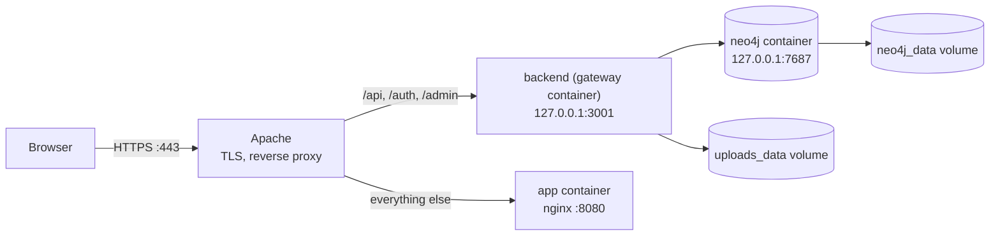

# Deployment and operations

Deployment is manual. An operator connects to the server over SSH and runs Docker Compose from
the repo's `compose.yaml`. No CI pipeline deploys anything.

The current staging server is `staging.t3planner.org`. The procedures below use `<domain>` for
the site's domain.

## Overview



Containers, all defined in `compose.yaml`:

| Container             | Compose service | Does                                             |
| --------------------- | --------------- | ------------------------------------------------ |
| `usccf-planning-tool` | `app`           | nginx serving the built wizard and graph editor. |
| `usccf-gateway`       | `gateway`       | The Express API.                                 |
| `usccf-neo4j`         | `neo4j`         | The database.                                    |

Volumes. Compose names them after the repo directory:

| Volume                                     | Holds               |
| ------------------------------------------ | ------------------- |
| `usccf-digital-planning-tool_neo4j_data`   | The Neo4j database. |
| `usccf-digital-planning-tool_uploads_data` | Uploaded PDFs.      |

Apache on the host:

- Terminates TLS with a Let's Encrypt certificate. `certbot.timer` renews it automatically.
- Redirects port 80 to HTTPS.
- Sends `/api`, `/auth` and `/admin` to the backend and everything else to the app container.
- Sets the `X-Forwarded-Proto: https` header. The backend needs it: without it, the session
  cookie is dropped and nobody can stay signed in.

## First-time server setup

1. Install Docker with the compose plugin, Apache and certbot.

2. Clone the repo into the home directory:

   ```sh
   git clone git@github.com:INFERable-app/USCCF-digital-planning-tool.git ~/USCCF-digital-planning-tool
   ```

   Keep this path. `scripts/neo4j-backup.service` and the backup script expect it.

3. Create the env file:

   ```sh
   cd ~/USCCF-digital-planning-tool
   cp .env.example .env
   ```

4. Fill in `.env`. See [configuration.md](configuration.md) for each variable. For a
   deployed site:
   - `GOOGLE_REDIRECT_URI=https://<domain>/auth/callback`
   - `WEB_ORIGIN=https://<domain>`
   - `ADMIN_EMAILS` holds at least your own email.

5. Add `https://<domain>/auth/callback` to the Google OAuth client's authorized redirect URIs.
   See [configuration.md](configuration.md#google-oauth-client).

6. Enable the Apache modules:

   ```sh
   sudo a2enmod proxy proxy_http headers rewrite ssl
   ```

7. Create `/etc/apache2/sites-available/planner.conf`:

   ```apache
   <VirtualHost *:80>
       ServerName <domain>
       ProxyPreserveHost On
       ProxyPass / http://localhost:8080/
       ProxyPassReverse / http://localhost:8080/
   </VirtualHost>
   ```

8. Enable the site and reload Apache:

   ```sh
   sudo a2ensite planner
   sudo systemctl reload apache2
   ```

9. Get a certificate. Certbot creates the HTTPS vhost and the port 80 redirect:

   ```sh
   sudo certbot --apache -d <domain>
   ```

10. Edit the HTTPS vhost certbot created, `/etc/apache2/sites-available/planner-le-ssl.conf`.
    Inside `<VirtualHost *:443>`, replace the proxy lines with:

    ```apache
    ProxyPreserveHost On
    RequestHeader set X-Forwarded-Proto "https"
    ProxyPass /api http://localhost:3001/api
    ProxyPassReverse /api http://localhost:3001/api
    ProxyPass /auth http://localhost:3001/auth
    ProxyPassReverse /auth http://localhost:3001/auth
    ProxyPass /admin http://localhost:3001/admin
    ProxyPassReverse /admin http://localhost:3001/admin
    ProxyPass / http://localhost:8080/
    ProxyPassReverse / http://localhost:8080/
    ```

    The order matters. The catch-all `/` must come last.

11. Reload Apache:

    ```sh
    sudo systemctl reload apache2
    ```

12. Build and start the containers:

    ```sh
    docker compose up -d --build
    ```

13. Seed the empty database:

    ```sh
    docker compose exec gateway node dist/seed/graphSeed.js
    ```

    Run this only once, on an empty database. See
    [Seeding](data-model.md#seeding).

14. Open `https://<domain>` and sign in with an email from `ADMIN_EMAILS`.

15. Install the backup timer. See [Backups](#backups).

## Deploying an update

1. Connect to the server:

   ```sh
   ssh <domain>
   ```

2. Go to the repo:

   ```sh
   cd ~/USCCF-digital-planning-tool
   ```

3. Pull the latest code:

   ```sh
   git pull origin main
   ```

4. Rebuild and restart the changed containers:

   ```sh
   docker compose up -d --build
   ```

5. Check the backend:

   ```sh
   curl -s localhost:3001/healthz
   ```

   Expect `{"status":"ok",...}`.

6. Open `https://<domain>` and sign in.

Restarting the backend signs every user out, because sessions live in memory. Saved progress
is kept.

## Rolling back

1. Find the last good commit:

   ```sh
   git log --oneline -10
   ```

2. Check it out:

   ```sh
   git checkout <commit>
   ```

3. Rebuild and restart:

   ```sh
   docker compose up -d --build
   ```

4. When the fix is on `main`, return to it with `git checkout main` and deploy as usual.

A rollback changes code only. Wizard content, progress and admins in Neo4j stay as they are.
To roll back data, restore a backup.

## Backups

`scripts/backup-neo4j.sh` makes a full dump of the Neo4j database. A systemd timer runs it
every day at 03:00 UTC.

What the script does:

1. Stops the `usccf-neo4j` container. Neo4j Community can only dump a stopped database.
2. Dumps the database with `neo4j-admin database dump` in a one-off `neo4j:5` container.
3. Starts Neo4j again.
4. Saves the dump as `/var/backups/usccf-neo4j/neo4j-<timestamp>.dump`.
5. Waits for the backend's `/healthz` to answer.
6. Deletes dumps older than 30 days.

While Neo4j is stopped, the API returns errors. This lasts a few seconds.

The script hard-codes four values. Edit the script if any of them change:

- the container name, `usccf-neo4j`
- the volume name, `usccf-digital-planning-tool_neo4j_data`
- the backup directory, `/var/backups/usccf-neo4j`
- the retention, 30 days

`scripts/neo4j-backup.service` also hard-codes the repo path,
`/home/natou/USCCF-digital-planning-tool`.

**The script does not back up uploaded PDFs.** See [Uploaded PDFs](#uploaded-pdfs).

### Installing the timer

1. Copy the units into systemd:

   ```sh
   sudo cp scripts/neo4j-backup.service scripts/neo4j-backup.timer /etc/systemd/system/
   ```

2. Load and start the timer:

   ```sh
   sudo systemctl daemon-reload
   sudo systemctl enable --now neo4j-backup.timer
   ```

3. Confirm the next run time:

   ```sh
   systemctl list-timers neo4j-backup.timer
   ```

### Checking backups

- List dumps: `ls -lh /var/backups/usccf-neo4j`
- Read the last run's output: `journalctl -u neo4j-backup.service -n 50`
- Run a backup now: `sudo systemctl start neo4j-backup.service`

## Restoring a backup

> This procedure has not been tested on this project yet. Practice it on a local copy before
> you need it in production.

A restore replaces the whole database: content, progress and admins.

1. Go to the repo:

   ```sh
   cd ~/USCCF-digital-planning-tool
   ```

2. Stop the backend and Neo4j:

   ```sh
   docker compose stop gateway neo4j
   ```

3. Copy the dump you want into an empty folder, named `neo4j.dump`:

   ```sh
   mkdir -p /tmp/neo4j-restore
   cp /var/backups/usccf-neo4j/neo4j-<timestamp>.dump /tmp/neo4j-restore/neo4j.dump
   chmod -R 777 /tmp/neo4j-restore
   ```

4. Load it into the database volume:

   ```sh
   docker run --rm \
     -v usccf-digital-planning-tool_neo4j_data:/data \
     -v /tmp/neo4j-restore:/backups \
     neo4j:5 neo4j-admin database load neo4j --from-path=/backups --overwrite-destination=true
   ```

5. Start Neo4j and the backend:

   ```sh
   docker compose start neo4j gateway
   ```

6. Check the backend with `curl -s localhost:3001/healthz`, then sign in and look at the
   wizard.

7. Delete the temporary folder:

   ```sh
   rm -rf /tmp/neo4j-restore
   ```

## Uploaded PDFs

Uploaded PDFs live in the `usccf-digital-planning-tool_uploads_data` volume. Nothing backs
them up automatically.

Back them up by hand into the current directory:

```sh
docker run --rm \
  -v usccf-digital-planning-tool_uploads_data:/uploads:ro \
  -v "$PWD":/out \
  alpine tar czf /out/uploads-$(date +%Y%m%d).tar.gz -C /uploads .
```

Restore an archive into the volume:

```sh
docker run --rm \
  -v usccf-digital-planning-tool_uploads_data:/uploads \
  -v "$PWD":/in \
  alpine tar xzf /in/uploads-<date>.tar.gz -C /uploads
```

## Routine operations

Run these on the server, from `~/USCCF-digital-planning-tool`.

### Check that everything is running

```sh
docker ps
curl -s localhost:3001/healthz
```

All three containers should show `Up`.

### Read logs

```sh
docker logs usccf-gateway --tail 200
docker logs usccf-neo4j --tail 200
```

Add `-f` to follow new lines.

### Query Neo4j

This reads the credentials from the container, so the password never appears in your shell
history:

```sh
docker exec usccf-neo4j bash -c 'cypher-shell -u "${NEO4J_AUTH%%/*}" -p "${NEO4J_AUTH##*/}" "MATCH (n:WizardNode) RETURN count(n);"'
```

[data-model.md](data-model.md#inspecting-the-data) lists more queries.

### Open the Neo4j Browser

Neo4j listens only on the server's localhost. Use an SSH tunnel from your own machine:

1. Open the tunnel:

   ```sh
   ssh -L 7474:localhost:7474 -L 7687:localhost:7687 <domain>
   ```

2. Open `http://localhost:7474` in your browser.

3. Connect to `bolt://localhost:7687` with the credentials from the server's `.env`.

### Get admin access back

Use this when nobody can reach the Admins panel.

1. Add the email to `ADMIN_EMAILS` in `.env`.
2. Restart the backend:

   ```sh
   docker compose up -d gateway
   ```

3. Sign in with that email and add the admin permanently in the Admins panel.

### Free disk space

Every build leaves old images behind.

1. Check usage:

   ```sh
   df -h /
   docker system df
   ```

2. Remove unused images and build cache:

   ```sh
   docker image prune -f
   docker builder prune -f
   ```

Never run `docker volume prune`. It can delete the database and uploads volumes.

### Renew the TLS certificate

`certbot.timer` renews it automatically. To check:

```sh
systemctl list-timers certbot.timer
sudo certbot renew --dry-run
```

## Known operational risks

Observed on staging. Each one is a candidate for a fix.

- **Nothing restarts after a reboot.** No container has a restart policy. After the server
  reboots, the site stays down until someone runs `docker compose up -d`.
- **Port 8080 is public.** `compose.yaml` publishes the app container on all interfaces. The
  static site answers on `http://<domain>:8080` over plain HTTP and bypasses Apache. Sign-in
  does not work there, because `/auth` and `/api` are not reachable on that port.
- **Backups stay on the same server.** Losing the server's disk loses the database and every
  backup.
- **Uploaded PDFs are not backed up.**
- **The backend does not wait for Neo4j.** `depends_on` only orders container start-up. If
  Neo4j is slow to start, the first requests fail.
- **Restarts sign everyone out.** Sessions live in the backend's memory.
